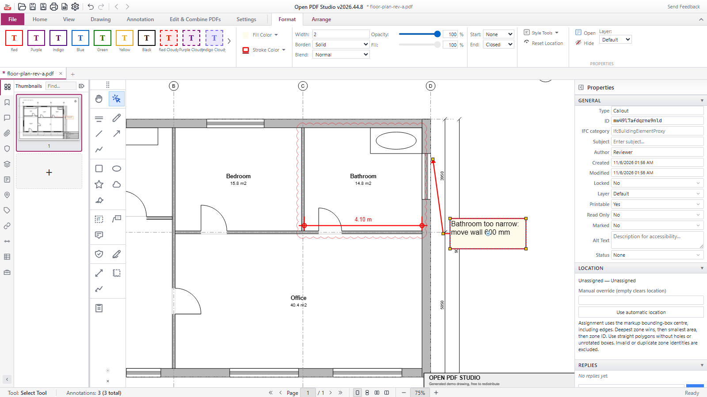
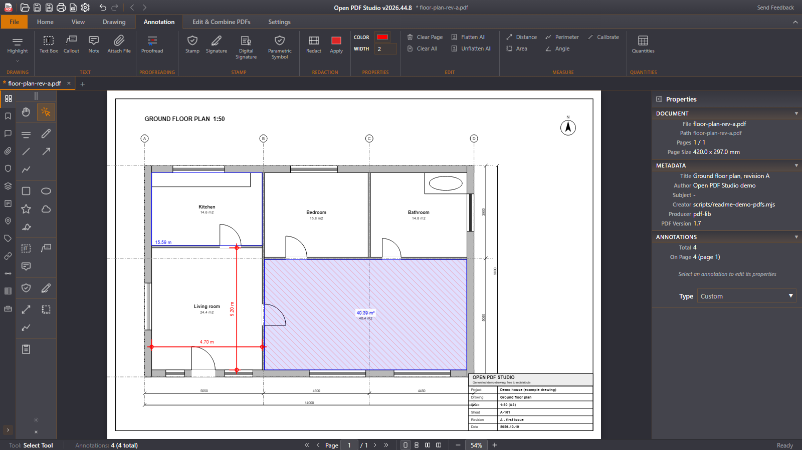
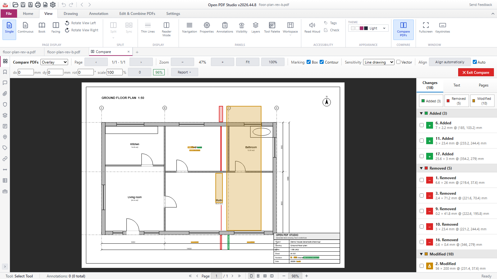
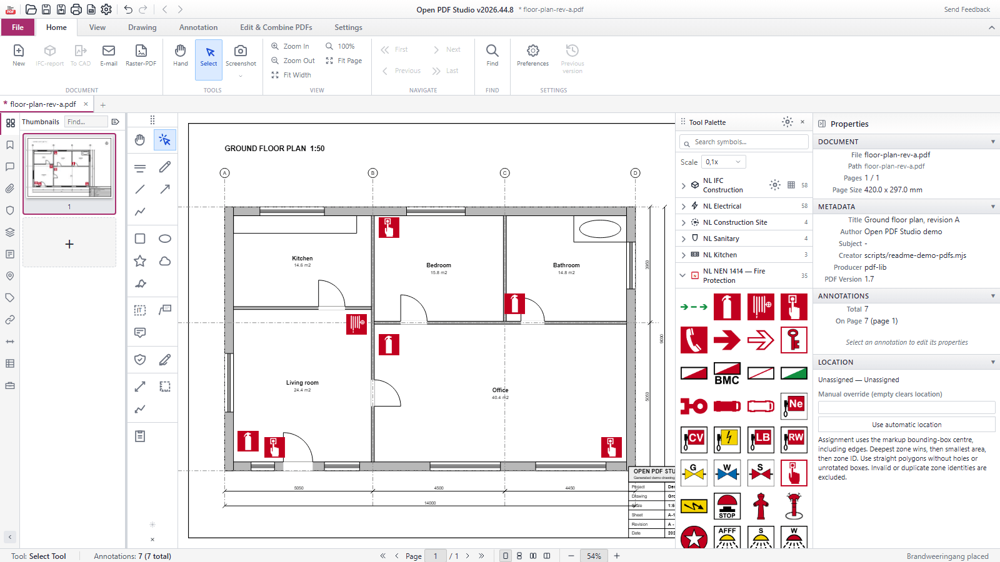
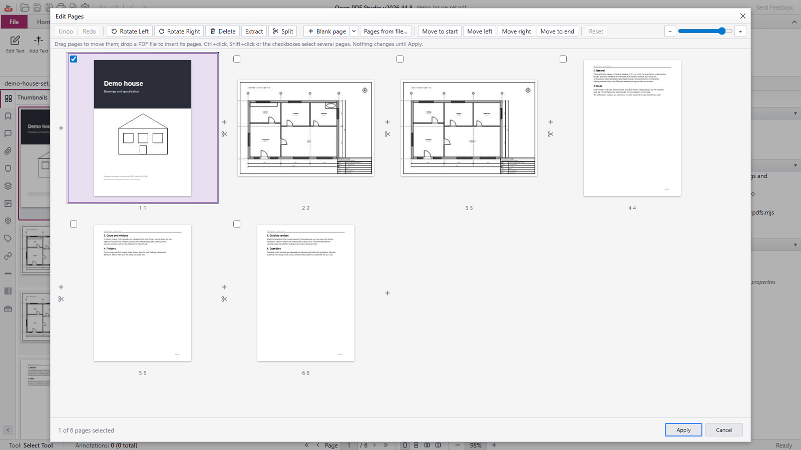
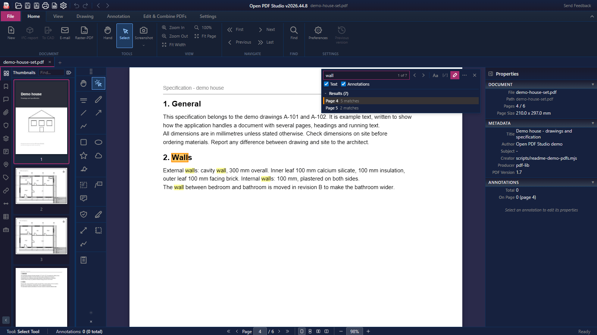
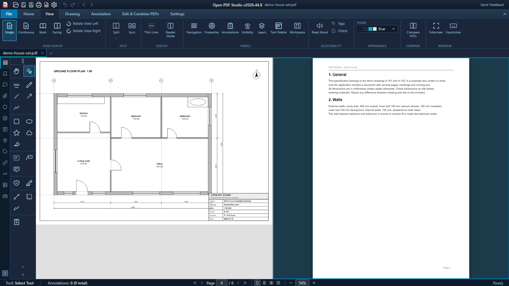

**English** · [Nederlands](README.nl.md)

<div align="center">

# Open PDF Studio

**A free, open-source PDF editor for people who work with drawings: markup, measuring to scale, revision compare and CAD import, on Windows, macOS, Linux, Android and in the browser.**

[](https://github.com/OpenAEC-Foundation/open-pdf-studio/releases/latest)
[](https://github.com/OpenAEC-Foundation/open-pdf-studio/actions/workflows/ci.yml)
[](#license)
[](open-pdf-studio/js/i18n/locales/)
[](mcp-stdio/tools.json)

### [Try in your browser](https://open-pdf-studio.open-aec.com/) &nbsp;·&nbsp; [Download](https://github.com/OpenAEC-Foundation/open-pdf-studio/releases/latest)



</div>

Open PDF Studio is a PDF editor for architects, engineers, contractors and everyone else who reviews drawings and documents. You mark up, measure with the scale the drawing carries, compare revisions, place symbols, count quantities and organise pages, with no subscription, account or watermark.

It runs as a desktop app on Windows, macOS and Linux, as an Android app, and in your browser with nothing to install. The desktop app adds what needs your computer: printing, OCR, DWG and DXF import and export, digital signatures and a local AI connection (MCP).

## Try it

**[Open the browser version](https://open-pdf-studio.open-aec.com/)** and open a PDF from your computer. You get the same ribbon, markup, measuring, compare, symbol and page tools as in the desktop app. Your document stays in your browser and is not uploaded; a page reload starts empty. Buttons for desktop-only features are switched off and say why.

## Download

Every release is on the [releases page](https://github.com/OpenAEC-Foundation/open-pdf-studio/releases/latest).

| Platform | Files |
|----------|-------|
| **Windows** | `…_x64-setup.exe` (all users, needs admin), `…_x64_user-setup.exe` (current user only), `…_x64_portable.zip` (no install, [details](docs/portable-windows.md)) |
| **macOS** | `…_universal.dmg` (Apple silicon and Intel, macOS 10.15 or later) |
| **Linux** | `.deb`, `.AppImage` and `.snap` for x86_64, also in the [Snap Store](https://snapcraft.io/open-pdf-studio); Nix flake. See [docs/install-linux.md](docs/install-linux.md) |
| **Android** | `open-pdf-studio-release.apk` (64-bit ARM) |
| **Other** | `open-pdf-studio.mcpb` (AI connection for MCP clients), `open-pdf-studio-web-<version>.tar.gz` (web version to host yourself), winget manifests, the Python library (`.whl` and `.tar.gz`) |

**Updates.** The Windows installers, the macOS app, the `.deb` and the AppImage check for updates and install them through the built-in updater, which only accepts updates signed with the project's update key. The snap updates through the Snap Store. The portable version and the Android app do not update themselves.

**Signing.** The Windows installers and the program files they install are Authenticode-signed with Azure Trusted Signing; the release workflow installs the signed installer and checks every signature. The macOS app is signed with a Developer ID and notarized by Apple; the workflow checks it with `codesign`, `spctl` and `stapler`. From the first release after 2026.45.0 (the signing job came later), the `.deb`, the AppImage and the snap each have a detached OpenPGP signature (`.asc`) of the OpenAEC Foundation release key, fingerprint `13F6D414ADEE4ED4CD09AC60601D86C93C504D29`, and `SHA256SUMS` with `SHA256SUMS.asc` covers the Linux files; check them with `gpg --verify <file>.asc <file>` against [`docs/keys/openaec-signing-public-key.asc`](docs/keys/openaec-signing-public-key.asc) (see [docs/install-linux.md](docs/install-linux.md#verifying-the-download-openpgp)). The `.sig` files are the update signatures that the built-in updater checks. The Android APK is signed, but with a new key for every release (see [Current limitations](#current-limitations)). The portable zip and the web bundle come with a `.sha256` file.

## Why use it?

- **Free and open.** LGPL-3.0-or-later. No licence fees, no account, no telemetry and no watermark ([PRIVACY.md](PRIVACY.md)).
- **Made for drawings.** Clouds, callouts, hatches, stamps and symbol libraries, and printing to scale on sheets up to A0.
- **Measure to scale at once.** A drawing that carries its own scale, such as a CAD plot or an imported DWG, measures correctly without calibrating.
- **See what changed.** Compare two revisions side by side or on top of each other, with a list of every change.
- **CAD in and out.** Import DWG and DXF as a vector PDF with layers and a measuring scale, and export a page back to DXF or DWG (desktop).
- **Works with an AI assistant.** A local MCP server with 94 tools lets an assistant open, mark up, measure and save documents for you (desktop).
- **Everywhere.** Windows, macOS, Linux, Android and the browser, in 40 languages.

## Screenshots

| | |
|---|---|
|  **Measuring with the scale of the drawing** |  **Comparing two revisions** |
|  **Symbols from the palette** |  **Organising pages** |
|  **Searching text and annotations, theme Dark** |  **Split view, theme Blue** |

The screenshots come from the browser version with demo PDFs that the script makes itself: `open-pdf-studio/scripts/generate-readme-screenshots.mjs`.

## Markup and measuring

- **Markup.** Highlights, shapes, clouds, callouts, text boxes, sticky notes, freehand, stamps, images and signatures, with styles, layers and alignment tools.
- **Measuring.** Distance, area, perimeter and angle, to the scale in the drawing or a scale you calibrate, with snapping to the drawing.
- **Quantities.** Count objects by category and collect counts, lengths and areas in a schedule that you place on the page or export as CSV.
- **Redaction.** Removes the text, images and vectors under the marked area from the file, not just from view.

The full list is in [docs/features.md](docs/features.md).

## Documents and pages

- **Pages.** Insert, delete, extract, split, rotate, reorder and merge; straighten a skewed scan or shift page content.
- **Forms, bookmarks and attachments.** Fill and create form fields, edit bookmarks, manage attachments.
- **Watermarks, headers and footers** with page numbers and dates.
- **Search** in the page text and in annotations, with a result list per page.
- **Keyboard shortcuts** that you can change, including a preset with single-letter markup keys: [docs/keyboard-shortcuts.md](docs/keyboard-shortcuts.md).

## Desktop features

- **CAD.** DWG and DXF import with layers, viewports and a measuring scale, and export of a page to DXF or DWG.
- **Printing** to scale on large sheets, with a live preview and *Save as PDF*.
- **OCR** to make scans searchable.
- **Digital signatures**: validation with the certificate chain, and signing.
- **Managed installs** with `OPENAEC_BEHEERD=1` and a fixed start folder: [docs/managed-deployments.md](docs/managed-deployments.md).

## Interoperability

| Format | Open / import | Save / export |
|--------|---------------|---------------|
| **PDF** | Yes, including forms (AcroForm, XFA) and layers | Yes; PDF/A validation and saving, PDF/X export, raster PDF, flattened copy |
| **XFDF** | Annotations; a tool set from sample markups | Annotations |
| **BCF 2.1** | Issues as annotations | Annotations as issues |
| **DWG, DXF** | Yes, as a vector PDF (desktop) | A page with its layers and markups (desktop) |
| **IFCX** (IFC5 JSON) | No | Yes, beta ([docs/ifcx-export.md](docs/ifcx-export.md)) |
| **PNG, JPEG** | As an image on a page | Pages, at 72 to 600 DPI |
| **DOCX, ODT, XLSX** | No | Text and tables |
| **CSV** | Edited tags of a saved quantities schedule (label, IFC category, location, count category) | Quantities schedule, with an ID column per markup |

What does not survive: XFDF and BCF carry annotations only, not the page content. A flattened copy leaves out form field values. DOCX, ODT and XLSX get the text and tables, and complex layouts may need correction. PDF/X keeps standard fonts that are not embedded as they are. What IFCX keeps and loses is listed in [docs/ifcx-export.md](docs/ifcx-export.md).

## Embedding in a web page

A separate, lightweight build lets another web application show a drawing with measuring and comments in its own page: `npm run build:web-unit` writes `open-pdf-studio/dist-web-unit/`. The script a host loads is about 10 KiB gzip; PDF.js arrives with the first document, the PDF writer only when the host asks for the result, and nothing in the unit uses the desktop shell. It uses the same annotation model as the desktop app, so a drawing marked up on the web opens the same way on the desktop.

```html
<div id="viewer" style="height:600px"></div>
<script type="module">
  import { mount } from './web-unit/open-pdf-studio.js';

  const unit = mount('#viewer', {
    scale: '1:100', unit: 'mm', lang: 'en', tools: ['measure', 'comment', 'shape'],
    onChange: ({ count }) => console.log(count, 'annotations'),
  });
  await unit.load('/drawings/123.pdf');           // a URL, bytes or a File
  const pdf = await unit.exportPdf();              // Uint8Array with the markups
  const annotations = unit.getAnnotations();       // the same JSON model as the desktop app
</script>
```

The same unit works as a `<open-pdf-studio src="…" scale="1:100">` element and inside an iframe with a `postMessage` protocol. Options include a read-only mode (`readOnly: true`), a dark theme and CSS variables, a hidden toolbar for hosts with their own buttons, and `storage: 'local'` to remember the page and scale per document (off by default). The events are `opds:load`, `opds:change`, `opds:save` and `opds:error`. A minimal host page is in [`open-pdf-studio/web-unit/voorbeeld/`](open-pdf-studio/web-unit/voorbeeld/index.html). The unit measures distances and places sticky notes and rectangles; area, perimeter, text boxes, editing existing annotations and XFDF are not in it yet ([#451](https://github.com/OpenAEC-Foundation/open-pdf-studio/issues/451)).

## MCP

The desktop app has a built-in MCP server, so an AI assistant can work with your documents: open and save files, navigate, create and edit annotations, set the measuring scale, take off quantities, import and export CAD and print to a PDF file. It has 94 public tools.

You stay in control. The server is on for a new installation and listens only on your own computer (`127.0.0.1`, port 9223); switch it off or change the port under Settings > General. The status bar shows when an assistant is connected and which tool it used last. `open-pdf-studio.mcpb` from the release installs the connection in MCP clients that support `.mcpb` bundles; [mcp-stdio/README.md](mcp-stdio/README.md) explains the bridge for other clients. A [Python library](docs/python-library.md) drives the same tools from a script.

**Where your document goes.** The MCP connection itself stays on your computer, but the assistant you connect decides where the work is done. If it uses an online AI service, the page text, screenshots and annotations it reads through the tools can be sent to that service. Check that service's data terms before you let it work on confidential drawings, or use an assistant with a model that runs locally.

## Testing and reliability

- **798 unit test files** run with `npm run test:unit` on Windows, Linux and macOS in [CI](.github/workflows/ci.yml) for every pull request, plus 3 quality regression test files (`npm run test:quality`).
- **CI builds the app on all three desktop platforms** and starts it: the AppImage on Debian 13, Fedora 44 and in OpenAEC Linux conditions, and the macOS app. It also tests the Python library, lints the Flatpak when it changes, and loads the hosted web bundle in headless Chromium under a strict content security policy.
- **Pull requests that touch rendering** also run a render regression on a large-format drawing and keep the report ([render-regression.yml](.github/workflows/render-regression.yml)).
- **Releases are checked before they are published.** The release workflow installs the signed Windows installer and checks every signature, starts the portable zip, verifies the macOS signature, notarization and start-up, and verifies the OpenPGP signatures of the Linux packages against the public key in the repository.
- **Privacy is tested.** A unit test fails when the shipped source contains an internet address that [PRIVACY.md](PRIVACY.md) does not list, or when a telemetry package is added.
- **README images are checked.** `node open-pdf-studio/scripts/check-readme-images.mjs` fails when an image is missing, unused or larger than 150 kB.

Count sources: unit test files are the non-comment lines of [`open-pdf-studio/scripts/unit-testlijst.txt`](open-pdf-studio/scripts/unit-testlijst.txt); quality tests are the `test:quality` script in [`open-pdf-studio/package.json`](open-pdf-studio/package.json); MCP tools are the entries in [`mcp-stdio/tools.json`](mcp-stdio/tools.json); languages are the folders in [`open-pdf-studio/js/i18n/locales/`](open-pdf-studio/js/i18n/locales/).

## Current limitations

- **Linux packages up to 2026.44.8 render without the worker pool.** They lacked the `pdfium-worker` sidecar, so every page rendered in-process and large documents were slow ([#923](https://github.com/OpenAEC-Foundation/open-pdf-studio/issues/923)). The fix is on `main` and ships with the next release.
- **On some Linux systems the app can still crash while zooming.** The app now lowers the realtime limit and turns off GPU acceleration of the page canvas, the two known causes; the issue stays open until that is confirmed on affected systems ([#924](https://github.com/OpenAEC-Foundation/open-pdf-studio/issues/924), workarounds in [docs/install-linux.md](docs/install-linux.md)).
- **An Android update does not install over the previous version.** Every release signs the APK with a new key, so Android refuses the update; uninstall the old version first ([#601](https://github.com/OpenAEC-Foundation/open-pdf-studio/issues/601)). The Android app has no OCR and renders with PDF.js.
- **The browser version has no desktop features.** Printing, OCR, CAD import and export, compression, PDF/X, IFC export, document protection, extensions, updates, the MCP server and signature validation need the desktop app.
- **Some virus scanners flag the Windows installer.** The installers are signed, but a new release has little reputation with the virus scanner built into Windows and similar scanners at first ([#761](https://github.com/OpenAEC-Foundation/open-pdf-studio/issues/761), [docs/windows-distribution.md](docs/windows-distribution.md)).
- **Printing to some third-party virtual PDF printers crashes that printer's own program** ([#699](https://github.com/OpenAEC-Foundation/open-pdf-studio/issues/699)).
- **Only x86_64 on Windows and Linux.** A Windows on ARM build exists only as an experimental workflow, there is no `.rpm`, and the Flatpak is not on Flathub yet ([docs/flathub.md](docs/flathub.md)).
- **The Table button on the Drawing tab is not available yet.** Place a quantities schedule as a table instead.

Found something? [Open an issue](https://github.com/OpenAEC-Foundation/open-pdf-studio/issues).

## Under the hood

The app is a [Tauri 2](https://tauri.app/) desktop app with a Rust back end and a [SolidJS](https://www.solidjs.com/) front end built with [Vite](https://vitejs.dev/). Pages render through a multi-process [PDFium](https://pdfium.googlesource.com/pdfium/) worker pool, off the UI thread and isolated from crashes, with progressive tiles for very large drawings; the browser and Android versions render with [PDF.js](https://mozilla.github.io/pdf.js/), which also provides the text layer. [pdf-lib](https://pdf-lib.js.org/) writes the PDF changes. The browser version is the same front end built without the Tauri shell. The licences of all components are in [LICENSING.md](LICENSING.md).

## Contributing

- **Report a bug or ask for a feature** as an [issue](https://github.com/OpenAEC-Foundation/open-pdf-studio/issues/new). Describe what you did, what you expected and what happened. Because the code moves quickly, a precise issue is often more useful than a pull request.
- **Share symbol libraries and other content.** Pull requests with symbol sets, hatch patterns and similar content from your country or discipline are very welcome.
- **Write code.** Read [CONTRIBUTING.md](CONTRIBUTING.md) first.

We are looking for someone to maintain the extensions and the content repository: curating incoming symbol libraries and keeping the catalogue organised. If that is you, open an issue to introduce yourself.

## Quick start (developers)

```bash
git clone https://github.com/OpenAEC-Foundation/open-pdf-studio.git
cd open-pdf-studio/open-pdf-studio
npm ci
npm run tauri:dev
```

Requires Node.js 22, Rust stable, CMake and a C/C++ toolchain, plus the WebKitGTK development packages on Linux. Details, release builds, the web version and tests are in [docs/building.md](docs/building.md).

Versions follow the OpenAEC scheme `YYYY.W.N`: year, ISO week without a leading zero, and a number within the week that starts at 0, such as `2026.44.8`.

Open PDF Studio is part of the [OpenAEC Foundation](https://github.com/OpenAEC-Foundation) family of apps.

## License

Open PDF Studio is licensed under the [GNU Lesser General Public License v3.0 or later](LICENSE.md). The LGPL builds on the [GNU General Public License v3.0](GPL-3.0.txt), whose text ships alongside it. [LICENSING.md](LICENSING.md) explains what that means in plain language, lists the licence of every component and of the third-party components the app ships with, and answers the AGPL question around the MuPDF dependency.
