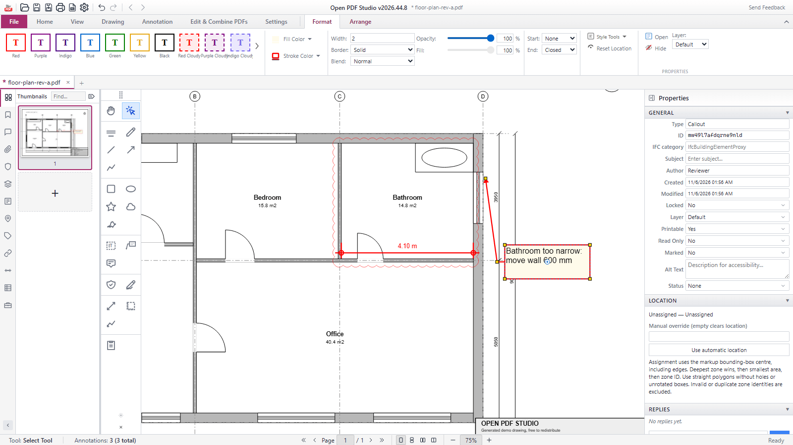
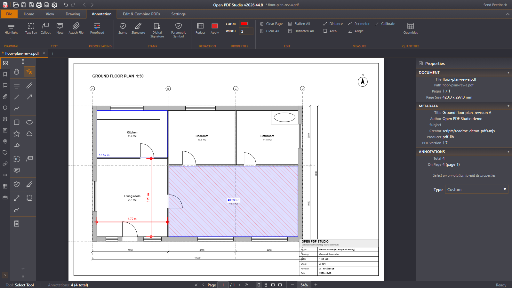
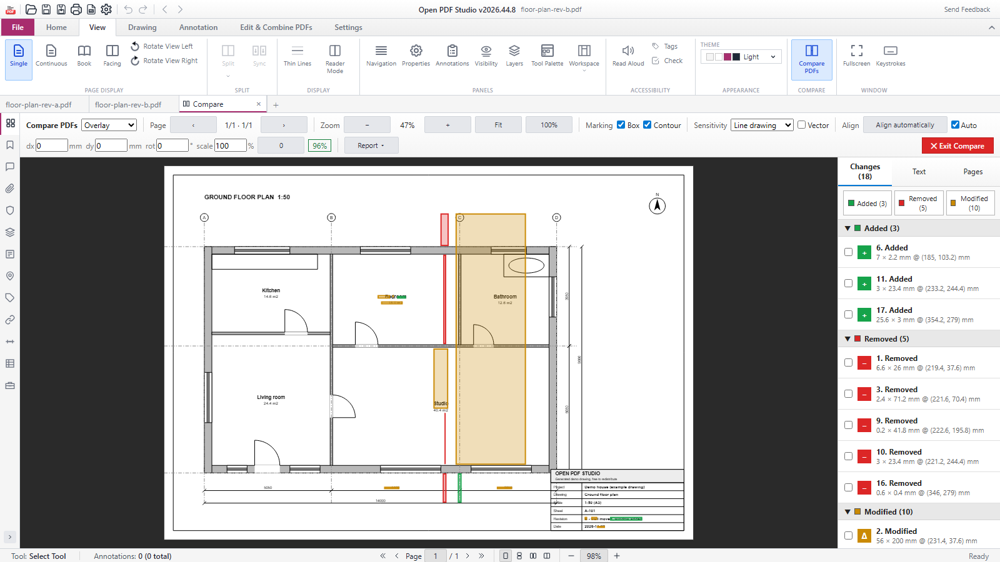
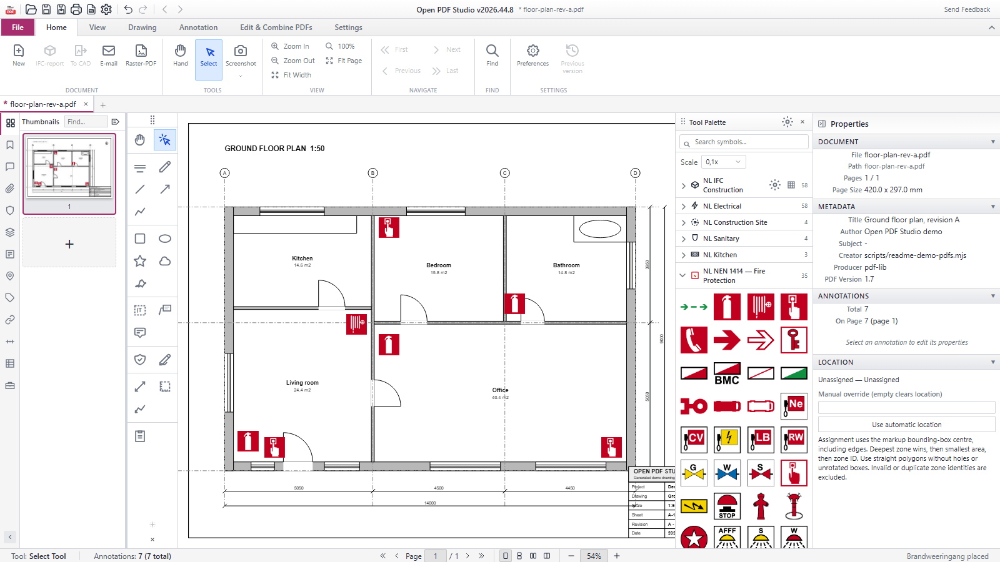
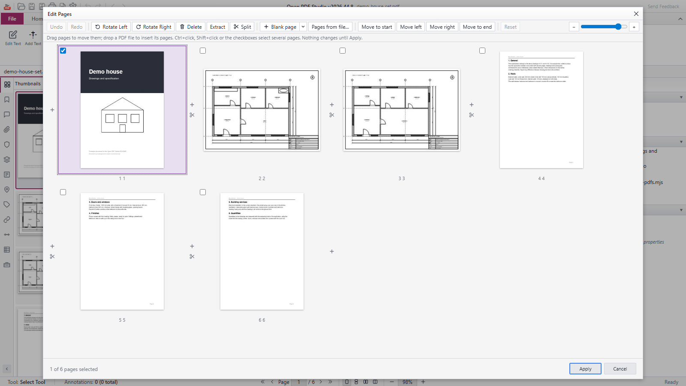
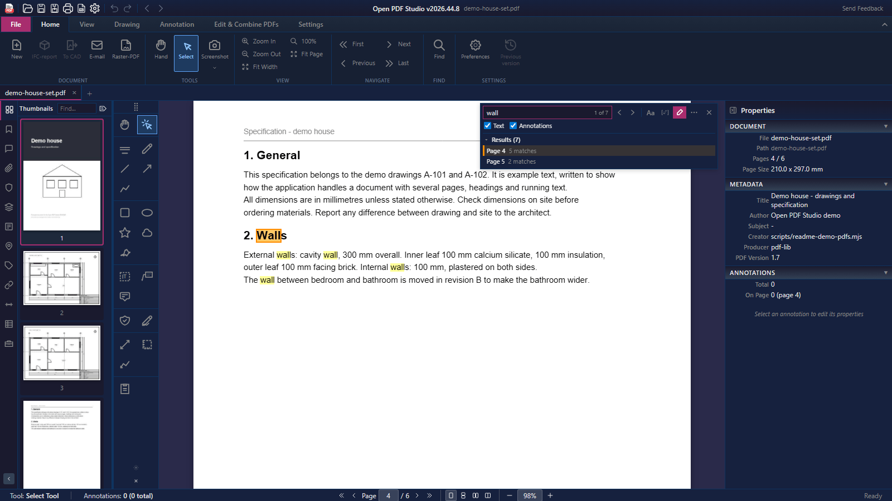
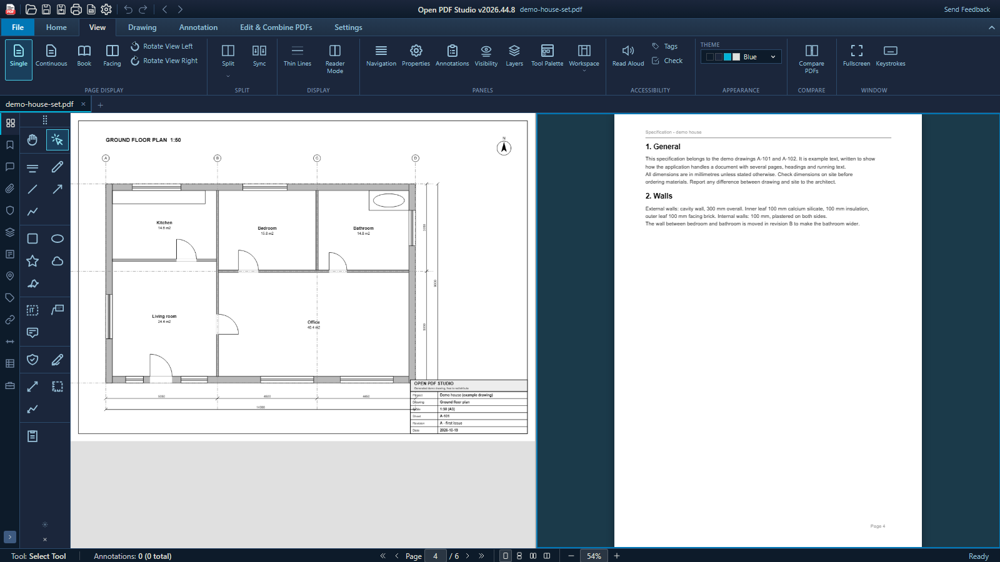

[English](README.md) · **Nederlands**

<div align="center">

# Open PDF Studio

**Een gratis, open-source PDF-editor voor wie met tekeningen werkt: markeren, meten op schaal, revisies vergelijken en CAD inlezen, op Windows, macOS, Linux, Android en in de browser.**

[](https://github.com/OpenAEC-Foundation/open-pdf-studio/releases/latest)
[](https://github.com/OpenAEC-Foundation/open-pdf-studio/actions/workflows/ci.yml)
[](#licentie)
[](open-pdf-studio/js/i18n/locales/)
[](mcp-stdio/tools.json)

### [Probeer in de browser](https://open-pdf-studio.open-aec.com/) &nbsp;·&nbsp; [Download](https://github.com/OpenAEC-Foundation/open-pdf-studio/releases/latest)



</div>

Open PDF Studio is een PDF-editor voor architecten, constructeurs, aannemers en iedereen die tekeningen en documenten controleert. Je markeert, meet met de schaal die de tekening meedraagt, vergelijkt revisies, plaatst symbolen, telt hoeveelheden en ordent pagina's, zonder abonnement, account of watermerk.

Het draait als desktop-app op Windows, macOS en Linux, als Android-app, en in je browser zonder iets te installeren. De desktop-app voegt toe wat je computer nodig heeft: afdrukken, OCR, DWG- en DXF-import en -export, digitale handtekeningen en een lokale AI-koppeling (MCP).

## Probeer het

**[Open de browserversie](https://open-pdf-studio.open-aec.com/)** en open een PDF van je computer. Je krijgt hetzelfde lint en dezelfde gereedschappen voor markeren, meten, vergelijken, symbolen en pagina's als in de desktop-app. Je document blijft in je browser en wordt niet geüpload; na herladen begint de pagina leeg. Knoppen voor functies die alleen op de desktop werken, staan uit en zeggen waarom.

## Downloaden

Elke release staat op de [releasepagina](https://github.com/OpenAEC-Foundation/open-pdf-studio/releases/latest).

| Platform | Bestanden |
|----------|-----------|
| **Windows** | `…_x64-setup.exe` (alle gebruikers, beheerdersrechten nodig), `…_x64_user-setup.exe` (alleen de huidige gebruiker), `…_x64_portable.zip` (zonder installatie, [details](docs/portable-windows.md)) |
| **macOS** | `…_universal.dmg` (Apple silicon en Intel, macOS 10.15 of nieuwer) |
| **Linux** | `.deb`, `.AppImage` en `.snap` voor x86_64, ook in de [Snap Store](https://snapcraft.io/open-pdf-studio); Nix-flake. Zie [docs/install-linux.md](docs/install-linux.md) |
| **Android** | `open-pdf-studio-release.apk` (64-bit ARM) |
| **Overig** | `open-pdf-studio.mcpb` (AI-koppeling voor MCP-clients), `open-pdf-studio-web-<versie>.tar.gz` (webversie om zelf te hosten); vanaf de volgende release ook winget-manifesten en de Python-bibliotheek |

**Bijwerken.** De Windows-installers, de macOS-app, de `.deb` en de AppImage zoeken en installeren updates met de ingebouwde updater, die alleen updates accepteert die met de updatesleutel van het project zijn ondertekend. De snap wordt bijgewerkt via de Snap Store. De draagbare versie en de Android-app werken zichzelf niet bij.

**Ondertekening.** De Windows-installers en de programmabestanden die ze installeren, zijn met Authenticode ondertekend via Azure Trusted Signing; de releaseworkflow installeert de ondertekende installer en controleert elke handtekening. De macOS-app is ondertekend met een Developer ID en door Apple genotariseerd; de workflow controleert dat met `codesign`, `spctl` en `stapler`. De `.deb`, de AppImage en de snap hebben elk een losse OpenPGP-handtekening (`.asc`) met de releasesleutel van de OpenAEC Foundation, vingerafdruk `13F6D414ADEE4ED4CD09AC60601D86C93C504D29`, en `SHA256SUMS` met `SHA256SUMS.asc` dekt de Linux-bestanden; controleer ze met `gpg --verify <bestand>.asc <bestand>` tegen [`docs/keys/openaec-signing-public-key.asc`](docs/keys/openaec-signing-public-key.asc) (zie [docs/install-linux.md](docs/install-linux.md#verifying-the-download-openpgp)). De `.sig`-bestanden zijn de updatehandtekeningen die de ingebouwde updater controleert. De Android-APK is ondertekend, maar met een nieuwe sleutel voor elke release (zie [Huidige beperkingen](#huidige-beperkingen)). De draagbare zip en de webbundel hebben een `.sha256`-bestand.

## Waarom gebruiken?

- **Gratis en open.** LGPL-3.0-or-later. Geen licentiekosten, geen account, geen telemetrie en geen watermerk ([PRIVACY.md](PRIVACY.md)).
- **Gemaakt voor tekeningen.** Wolken, tekstballonnen, arceringen, stempels en symboolbibliotheken, en afdrukken op schaal op bladen tot A0.
- **Meteen op schaal meten.** Een tekening die haar eigen schaal meedraagt, zoals een CAD-plot of een ingelezen DWG, meet je zonder te kalibreren.
- **Zie wat er veranderde.** Vergelijk twee revisies naast of over elkaar, met een lijst van elke wijziging.
- **CAD erin en eruit.** Lees DWG en DXF in als vector-PDF met lagen en meetschaal, en exporteer een pagina terug naar DXF of DWG (desktop).
- **Werkt met een AI-assistent.** Een lokale MCP-server met 94 gereedschappen laat een assistent documenten voor je openen, markeren, meten en opslaan (desktop).
- **Overal.** Windows, macOS, Linux, Android en de browser, in 40 talen.

## Schermafbeeldingen

| | |
|---|---|
|  **Meten met de schaal van de tekening** |  **Twee revisies vergelijken** |
|  **Symbolen uit het palet** |  **Pagina's ordenen** |
|  **Zoeken in tekst en markeringen, thema Dark** |  **Gesplitste weergave, thema Blue** |

De schermafbeeldingen zijn in het Engels. Ze komen uit de browserversie, met demo-PDF's die het script zelf maakt: `open-pdf-studio/scripts/generate-readme-screenshots.mjs`.

## Markeren en meten

- **Markeren.** Markeerstift, vormen, wolken, tekstballonnen, tekstvakken, notities, uit de vrije hand, stempels, afbeeldingen en handtekeningen, met stijlen, lagen en uitlijngereedschap.
- **Meten.** Afstand, oppervlakte, omtrek en hoek, op de schaal in de tekening of een schaal die je kalibreert, met snappen op de tekening.
- **Hoeveelheden.** Tel objecten per categorie en verzamel aantallen, lengtes en oppervlakten in een staat die je op de pagina plaatst of als CSV exporteert.
- **Weglakken.** Verwijdert de tekst, afbeeldingen en vectoren onder het gemarkeerde vlak uit het bestand, niet alleen uit beeld.

De volledige lijst staat in [docs/features.md](docs/features.md) (Engels).

## Documenten en pagina's

- **Pagina's.** Invoegen, verwijderen, uitnemen, splitsen, draaien, herschikken en samenvoegen; een scheve scan rechtzetten of de inhoud van een pagina verschuiven.
- **Formulieren, bladwijzers en bijlagen.** Formuliervelden invullen en maken, bladwijzers bewerken, bijlagen beheren.
- **Watermerken, kop- en voetteksten** met paginanummers en datums.
- **Zoeken** in de paginatekst en in markeringen, met een resultatenlijst per pagina.
- **Sneltoetsen** die je kunt aanpassen, met een voorinstelling met markeertoetsen van één letter: [docs/keyboard-shortcuts.md](docs/keyboard-shortcuts.md) (Engels).

## Functies op de desktop

- **CAD.** DWG- en DXF-import met lagen, viewports en meetschaal, en export van een pagina naar DXF of DWG.
- **Afdrukken** op schaal op grote bladen, met een live voorbeeld en *Opslaan als PDF*.
- **OCR** om scans doorzoekbaar te maken.
- **Digitale handtekeningen**: controle met de certificaatketen, en ondertekenen.
- **Beheerde installaties** met `OPENAEC_BEHEERD=1` en een vaste startmap: [docs/managed-deployments.md](docs/managed-deployments.md) (Engels).

## Uitwisseling

| Formaat | Openen / importeren | Opslaan / exporteren |
|---------|---------------------|----------------------|
| **PDF** | Ja, ook formulieren (AcroForm, XFA) en lagen | Ja; PDF/A controleren en opslaan, PDF/X-export, raster-PDF, platgemaakte kopie |
| **XFDF** | Markeringen | Markeringen |
| **BCF 2.1** | Issues als markeringen | Markeringen als issues |
| **DWG, DXF** | Ja, als vector-PDF (desktop) | Een pagina met lagen en markeringen (desktop) |
| **IFCX** (IFC5-JSON) | Nee | Ja, bèta ([docs/ifcx-export.md](docs/ifcx-export.md)) |
| **PNG, JPEG** | Als afbeelding op een pagina | Pagina's, op 72 tot 600 DPI |
| **DOCX, ODT, XLSX** | Nee | Tekst en tabellen |
| **CSV** | Nee | Hoeveelhedenstaat |

Wat er verloren gaat: XFDF en BCF bevatten alleen markeringen, niet de inhoud van de pagina. Een platgemaakte kopie laat de waarden van formuliervelden weg. DOCX, ODT en XLSX krijgen de tekst en tabellen; een ingewikkelde opmaak moet je soms nalopen. PDF/X laat standaardlettertypen die niet zijn ingebed zoals ze zijn. Wat IFCX meeneemt en verliest, staat in [docs/ifcx-export.md](docs/ifcx-export.md).

## MCP

De desktop-app heeft een ingebouwde MCP-server, zodat een AI-assistent met je documenten kan werken: bestanden openen en opslaan, navigeren, markeringen maken en wijzigen, de meetschaal zetten, hoeveelheden uittrekken, CAD in- en uitvoeren en afdrukken naar een PDF-bestand. Hij heeft 94 openbare gereedschappen.

Jij houdt de regie. De server staat aan bij een nieuwe installatie en luistert alleen op je eigen computer (`127.0.0.1`, poort 9223); zet hem uit of kies een andere poort onder Settings > General. De statusbalk laat zien wanneer een assistent verbonden is en welk gereedschap hij het laatst gebruikte. `open-pdf-studio.mcpb` uit de release installeert de koppeling in MCP-clients die `.mcpb`-bundels ondersteunen; [mcp-stdio/README.md](mcp-stdio/README.md) legt de brug voor andere clients uit. Een [Python-bibliotheek](docs/python-library.md) bedient dezelfde gereedschappen vanuit een script.

**Waar je document heen gaat.** De MCP-verbinding zelf blijft op je computer, maar de assistent die je koppelt bepaalt waar het werk gebeurt. Gebruikt die een online AI-dienst, dan kunnen de paginatekst, schermafbeeldingen en markeringen die hij via de gereedschappen leest naar die dienst gaan. Lees de gegevensvoorwaarden van die dienst voordat je hem op vertrouwelijke tekeningen loslaat, of gebruik een assistent met een model dat lokaal draait.

## Testen en betrouwbaarheid

- **746 unittestbestanden** draaien met `npm run test:unit` op Windows, Linux en macOS in [CI](.github/workflows/ci.yml) bij elke pull request, plus 3 testbestanden voor kwaliteitsregressie (`npm run test:quality`).
- **CI bouwt de app op alle drie de desktopplatforms** en start hem: de AppImage op Debian 13, Fedora 44 en onder OpenAEC Linux-omstandigheden, en de macOS-app. Daarnaast test CI de Python-bibliotheek, controleert de Flatpak als die verandert, en laadt de gehoste webbundel in headless Chromium onder een strikte content security policy.
- **Pull requests die aan het tekenen van pagina's komen**, draaien ook een renderregressie op een tekening op groot formaat en bewaren het rapport ([render-regression.yml](.github/workflows/render-regression.yml)).
- **Releases worden gecontroleerd voordat ze uitkomen.** De releaseworkflow installeert de ondertekende Windows-installer en controleert elke handtekening, start de draagbare zip, controleert ondertekening, notarisatie en opstarten van de macOS-app, en controleert de OpenPGP-handtekeningen van de Linux-pakketten tegen de publieke sleutel in de repository.
- **Privacy wordt getest.** Een unittest faalt als de meegeleverde broncode een internetadres bevat dat niet in [PRIVACY.md](PRIVACY.md) staat, of als er een telemetriepakket bijkomt.
- **De README-beelden worden gecontroleerd.** `node open-pdf-studio/scripts/check-readme-images.mjs` faalt als een beeld ontbreekt, niet gebruikt wordt of groter is dan 150 kB.

Bron van de getallen: de unittestbestanden zijn de regels zonder `#` in [`open-pdf-studio/scripts/unit-testlijst.txt`](open-pdf-studio/scripts/unit-testlijst.txt); de kwaliteitstests zijn het script `test:quality` in [`open-pdf-studio/package.json`](open-pdf-studio/package.json); de MCP-gereedschappen zijn de items in [`mcp-stdio/tools.json`](mcp-stdio/tools.json); de talen zijn de mappen in [`open-pdf-studio/js/i18n/locales/`](open-pdf-studio/js/i18n/locales/).

## Huidige beperkingen

- **Linux-pakketten tot en met 2026.44.8 tekenen zonder de workerpool.** Ze misten de `pdfium-worker`, dus elke pagina werd in het hoofdproces getekend en grote documenten waren traag ([#923](https://github.com/OpenAEC-Foundation/open-pdf-studio/issues/923)). De oplossing staat op `main` en komt mee met de volgende release.
- **Op sommige Linux-systemen kan de app nog vastlopen bij zoomen.** De app verlaagt nu de realtime-grens en zet de GPU-versnelling van het paginacanvas uit, de twee bekende oorzaken; het issue blijft open tot dat op getroffen systemen bevestigd is ([#924](https://github.com/OpenAEC-Foundation/open-pdf-studio/issues/924), oplossingen in [docs/install-linux.md](docs/install-linux.md)).
- **Een Android-update installeert niet over de vorige versie.** Elke release ondertekent de APK met een nieuwe sleutel, dus Android weigert de update; verwijder eerst de oude versie ([#601](https://github.com/OpenAEC-Foundation/open-pdf-studio/issues/601)). De Android-app heeft geen OCR en tekent met PDF.js.
- **De browserversie heeft geen desktopfuncties.** Afdrukken, OCR, CAD-import en -export, comprimeren, PDF/X, IFC-export, documentbeveiliging, extensies, updates, de MCP-server en het controleren van handtekeningen vragen de desktop-app.
- **Sommige virusscanners slaan aan op de Windows-installer.** De installers zijn ondertekend, maar een nieuwe release heeft eerst weinig reputatie bij de virusscanner van Windows en vergelijkbare scanners ([#761](https://github.com/OpenAEC-Foundation/open-pdf-studio/issues/761), [docs/windows-distribution.md](docs/windows-distribution.md)).
- **Afdrukken naar sommige virtuele PDF-printers van derden laat het programma van die printer vastlopen** ([#699](https://github.com/OpenAEC-Foundation/open-pdf-studio/issues/699)).
- **Alleen x86_64 op Windows en Linux.** Een build voor Windows op ARM bestaat alleen als experimentele workflow, er is geen `.rpm`, en de Flatpak staat nog niet op Flathub ([docs/flathub.md](docs/flathub.md)).
- **De knop Table op het lintblad Drawing werkt nog niet.** Plaats in plaats daarvan een hoeveelhedenstaat als tabel.

Iets gevonden? [Maak een issue](https://github.com/OpenAEC-Foundation/open-pdf-studio/issues).

## Onder de motorkap

De app is een [Tauri 2](https://tauri.app/)-desktop-app met een Rust-achterkant en een [SolidJS](https://www.solidjs.com/)-voorkant, gebouwd met [Vite](https://vitejs.dev/). Pagina's worden getekend door een workerpool van [PDFium](https://pdfium.googlesource.com/pdfium/)-processen, buiten de UI-thread en afgeschermd tegen crashes, met tegels die geleidelijk verschijnen bij heel grote tekeningen; de browser- en Android-versie tekenen met [PDF.js](https://mozilla.github.io/pdf.js/), dat ook de tekstlaag levert. [pdf-lib](https://pdf-lib.js.org/) schrijft de wijzigingen in de PDF. De browserversie is dezelfde voorkant, gebouwd zonder de Tauri-schil. De licenties van alle onderdelen staan in [LICENSING.md](LICENSING.md).

## Bijdragen

- **Meld een fout of vraag om een functie** in een [issue](https://github.com/OpenAEC-Foundation/open-pdf-studio/issues/new). Beschrijf wat je deed, wat je verwachtte en wat er gebeurde. Omdat de code snel verandert, is een precies issue vaak nuttiger dan een pull request.
- **Deel symboolbibliotheken en andere inhoud.** Pull requests met symboolsets, arceringen en vergelijkbare inhoud uit je land of vakgebied zijn van harte welkom.
- **Schrijf code.** Lees eerst [CONTRIBUTING.md](CONTRIBUTING.md).

We zoeken iemand die de extensies en de inhoudsrepository beheert: binnenkomende symboolbibliotheken beoordelen en de catalogus overzichtelijk houden. Ben jij dat, maak dan een issue om je voor te stellen.

## Snel aan de slag (ontwikkelaars)

```bash
git clone https://github.com/OpenAEC-Foundation/open-pdf-studio.git
cd open-pdf-studio/open-pdf-studio
npm ci
npm run tauri:dev
```

Vereist Node.js 22, Rust stable, CMake en een C/C++-toolchain, plus de WebKitGTK-ontwikkelpakketten op Linux. Details, releasebuilds, de webversie en de tests staan in [docs/building.md](docs/building.md) (Engels).

Versies volgen het OpenAEC-schema `JJJJ.W.N`: jaar, ISO-week zonder voorloopnul, en een volgnummer binnen de week dat bij 0 begint, zoals `2026.44.8`.

Open PDF Studio hoort bij de familie van apps van de [OpenAEC Foundation](https://github.com/OpenAEC-Foundation).

## Licentie

Open PDF Studio valt onder de [GNU Lesser General Public License v3.0 of later](LICENSE.md). De LGPL bouwt voort op de [GNU General Public License v3.0](GPL-3.0.txt), waarvan de tekst erbij zit. [LICENSING.md](LICENSING.md) legt in gewone taal uit wat dat betekent, noemt de licentie van elk onderdeel en van de onderdelen van derden die de app meelevert, en beantwoordt de AGPL-vraag rond de MuPDF-afhankelijkheid.
